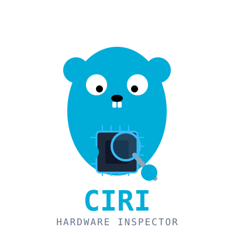
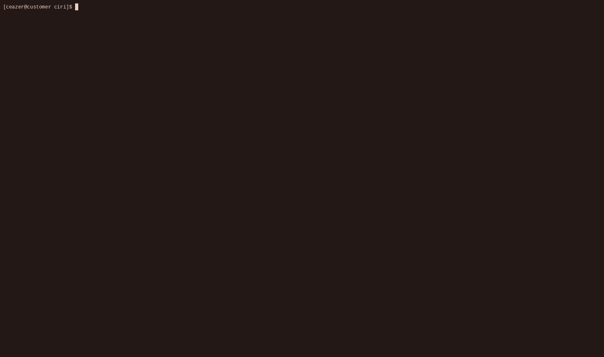

<p align="center">
  
</p>

<h1 align="center">ciri — Can I Run It?</h1>

<p align="center">
  <a href="https://github.com/cezaryt5/ciri/blob/main/LICENSE"></a>
  <a href="https://go.dev"></a>
  <a href="https://github.com/cezaryt5/ciri/stargazers"></a>
  <a href="https://discord.gg/ruyzNveUE"></a>
</p>

<p align="center">
  A terminal tool that answers: <strong>which open-source LLMs can run on my machine, and how fast?</strong>
</p>

<p align="center">
  
</p>

It detects your GPU, CPU, and RAM, then matches them against a catalog of 1,700+ model families and 23,000+ quant variants from Hugging Face. Instead of guessing whether an 8B model will fit in your VRAM, you get concrete numbers — estimated tokens per second, memory pressure, and whether the model fits comfortably or will spill into system RAM.

## Installation

**Go install** (requires Go 1.26+):

```sh
go install github.com/cezaryt5/ciri/cmd/ciri@v1.0.0
```

**Build from source:**

```sh
git clone https://github.com/cezaryt5/ciri
cd ciri
go build -o ciri ./cmd/ciri
```

All data files are embedded in the binary — no external files needed at runtime.

**Pre-built binary** is included in the repository (`ciri` in the project root).

## Usage

```sh
ciri
```

That's it. The tool starts an interactive terminal interface with eight screens:

| Screen | What it shows |
|--------|---------------|
| **Chat** | Local model chat through DeepSeek Harness, with live per-step inference analysis: prompt/generation throughput, TTFT, KV cache reuse, GPU utilization, VRAM, temperature, power and clocks. |
| **Home** | Menu: Chat, Explore Models, Downloads, Manage Local LLMs, Settings / Hardware |
| **Explore Models** | All 1,700+ canonical model families, filterable by actual type (generative, VLM, OCR, ASR, TTS, audio, diffusion, embedding) and density (dense/MoE), fit, search; sortable by column with asc/desc |
| **Detail** | Model specs plus every quant, grouped under the preferred publisher source. Recommended quants are the ones that fit your GPU; all other sources and quants are selectable. |
| **Benchmarks** | Real-world tok/s measurements from benchmark data, matched to the closest available GPU |
| **Downloads** | Download manager: active, queued, and completed downloads for the session. Downloads start from a model's detail page. |
| **Manage Local LLMs** | (coming soon) |
| **Settings** | Hardware configuration (GPU, VRAM, RAM, CPU, Ollama/llama.cpp status) |

### Keyboard controls

| Key | Action |
|-----|--------|
| `↑` `↓` / `j` `k` | Navigate lists |
| `Enter` / `Space` | Select / open |
| `Esc` | Go back |
| `q` / `Ctrl+C` | Quit |
| | **On Explore screen:** |
| `/` | Search models by name, quant, or parameter count |
| `s` | Cycle sort column (Name → Params → Speed → Disk → Date → Fit) |
| `S` | Tap to flip sort direction; press twice quickly for the arrow sort editor — `←`/`→` pick the column, `↑`/`↓` set ascending/descending, `Esc` exits |
| `t` | Filter by type (All / Coding / Chat / Vision / Translation / General) |
| `f` | Filter by fit (All / Perfect / Good / Slow) |
| `b` | Open benchmarks for selected model |
| | **On Detail screen:** |
| `Enter` | Choose a source (if several) and start the download |
| `d` | Download the selected quant from its preferred source |
| | **On Chat screen:** |
| `Enter` | Send the prompt |
| `Ctrl+O` | Toggle full analysis of all model calls |
| `Ctrl+N` | Start a new dsh session |
| `Ctrl+S` | Export analysis records and a Chrome Trace/Perfetto timeline as JSON |
| `Ctrl+R` | Re-probe `llama-server` (model, context and sampling defaults) |
| `PgUp` / `PgDn` | Scroll the transcript or analysis |
| `Esc` | Cancel a running prompt, or go back |
| `Ctrl+C` | Quit |
| | **On Download screen:** |
| `↑` `↓` / `j` `k` | Move through downloads |
| `x` | Cancel the selected active or queued download |
| `c` | Clear completed/failed history |
| `Esc` | Back to where you came from — the download keeps running |
| | **When a second download starts:** |
| `c` | Run it concurrently (at most two active) |
| `s` / `Esc` | Queue it and keep one download at a time |

### Interface

The TUI follows the *Void Protocol* design system: a solid void-black
(`#000000`) canvas, stark white for primary content, muted greys for labels and
structure, and a single signal red reserved for warnings. The chosen colors are
the only colors — the terminal's own background theme never shows through.

### Chat and inference analysis

`Chat` drives a local model through [DeepSeek Harness](https://github.com/deepseek-ai/deepseek-harness) in headless JSON mode, so the model gets dsh's tools, session persistence and workspace-write sandbox. Ciri places a small local OpenAI-compatible proxy in front of `llama-server`; the proxy records each model call without changing the bytes dsh receives.

Per model step the analysis panel shows:

- requested sampling settings (temperature, top_p, top_k, min_p, max tokens)
- prompt tokens, cached tokens and prompt-processing throughput
- generated tokens, generation throughput, TTFT and token-gap p50/p95
- reasoning-token estimate, context/KV usage and cache hit percentage
- GPU utilization, memory-controller utilization, VRAM, temperature, power, SM/memory clocks, throttle reasons and sparklines

`Ctrl+O` expands the panel to all model calls in the Ciri session so changes between runs can be compared. The analysis is runtime-level: kernel traces require Nsight Systems and are not part of this view.

Prerequisites:

```sh
# llama-server with an OpenAI-compatible API
llama-server -m model.gguf -ngl 99 -fa on -c 32768 --port 8081

# DeepSeek Harness (or set CIRI_DSH_BIN to a dsh executable)
npx @deepseek-ai/dsh --version
```

Environment variables:

| Variable | Default | Meaning |
|---|---|---|
| `CIRI_CHAT_SERVER` | `http://127.0.0.1:8081` | llama-server base URL |
| `CIRI_CHAT_WORKSPACE` | `~/.ciri/chat` | dsh working directory / sandbox write root |
| `CIRI_CHAT_CONTEXT` | probe from `/props` | context override if the server cannot report it |
| `CIRI_DSH_BIN` | auto-detect | explicit dsh executable |
| `CIRI_DSH_VERSION` | `0.2.2-rc.1` | npx fallback version |

dsh's sandbox confines **writes** to the workspace. Reads and network access are not restricted by dsh's local sandbox; run dsh inside a container or VM if you need a stronger boundary.

### Live telemetry

While `ciri` is open, the header strip samples the machine every 2 seconds:

- **CPU** — utilization % and package temperature
- **Memory** — used / total RAM
- **GPU** — utilization %, used / total VRAM, temperature, and power draw
  (NVIDIA via `nvidia-smi`; AMD GPUs are read from the `amdgpu` sysfs counters)

Fields a platform cannot expose (for example GPU load on macOS, which requires
root) render as dashes instead of guesses. Sampling is off the UI goroutine and
costs well under 1% of a core.

### Model downloads

Downloads are handled natively in Go — no `aria2c`, `hf`, or `wget` binary is
required. The engine opens several ranged HTTP connections per file, writes into
a sparse `.part` file, persists a small JSON sidecar for resume, retries
transient failures with backoff, verifies the LFS SHA-256 when the hub provides
one, and only then atomically renames the file into place.

Files are stored under `~/.ciri/models/<owner>/<repo>/`. Set `CIRI_MODELS_DIR`
to override the root. Gated/private repositories use `HF_TOKEN` (or
`HUGGING_FACE_HUB_TOKEN`) if present.

## How it works

> For a deep dive into the system architecture, data flows, and every module, see [**docs/DOCUMENTAION.md**](docs/DOCUMENTAION.md).

### Hardware detection

On startup, `ciri` detects your hardware:

- **GPU** — identified through a three-tier matching strategy ([PCI device ID → vendor API like nvidia-smi or rocm-smi → fuzzy name matching](docs/DOCUMENTAION.md#5-gpu-matching-strategies)), cross-referenced against a database of 200+ GPUs with VRAM, bandwidth, and TFLOPS figures
- **CPU** — model name and core count via `ghw`
- **RAM** — total and available system memory
- **Toolchain** — checks whether `ollama` and `llama.cpp` are in your `$PATH`

Apple Silicon Macs are handled with unified memory accounting.

### Model catalog

1,700+ canonical model families sourced from Hugging Face, each with:

- Parameter count, architecture, context length, license
- Actual model type (generative, VLM, OCR, ASR, TTS, audio, diffusion, embedding, other) and density (dense/MoE)
- Every quant variant, grouped by quant label and publisher source
- Exact on-disk size per quant, computed from the Hub’s file sizes
- Community stats (downloads, likes)

The first catalog contains canonical models, not repos. Opening a model shows its basic info, the quants that fit your GPU first, then every other quant. Quants with multiple publishers are grouped under a preferred source; the other sources remain selectable.

### Fit assessment

Every model is checked against your hardware:

- **Recommended** — fits entirely in your VRAM (with a 10% buffer), will run at full speed
- **Advanced** — needs more VRAM than you have but fits in system RAM; will run, but slowly
- **Too heavy** — exceeds both VRAM *and* available system RAM

The VRAM requirement used is the larger of the model's `min_vram_gb` and its actual weight size (`parameters × bytes_per_param(quantization)`), so the assessment is always honest — even if the catalog's minimum is set too low.

See [VRAM fit checking](docs/DOCUMENTAION.md#7-prediction-engine) for the exact logic.

### Speed estimation

Estimated tokens per second comes from a [three-tier cascade](docs/DOCUMENTAION.md#8-speed-estimation):

1. **Benchmark** — exact match from the benchmark cache (real measurements on similar hardware)
2. **Architecture scaling** — no exact match, but data exists for the same GPU architecture family
3. **Heuristic** — memory-bandwidth-bound or compute-bound estimation using the GPU's raw specs

If a model spills to system RAM, a 0.2x penalty is applied to the estimate.

## Data files

All data files are embedded in the binary at build time:

| Data | Contents |
|------|----------|
| GPU database | 200+ GPU profiles (VRAM, bandwidth, TFLOPS, PCI IDs, architecture family) |
| Model catalog | 1,700+ canonical families, 23,000+ quant variants, exact file sizes |
| Legacy model catalog | Flat `hf_models.json` fallback for older/source-only builds |
| Benchmark cache | Real-world tok/s measurements indexed by GPU and model |

The new catalog is generated by `tools/reshape_catalog.py` from the raw GGUF
scrape. It is embedded as `catalog_v2.json.gz`; rebuild it with:

```sh
python3 tools/reshape_catalog.py --source data/gguf_catalog.json --out data/catalog_v2.json
gzip -9 -c data/catalog_v2.json > data/catalog_v2.json.gz
```

For development, `CIRI_CATALOG=data/catalog_v2.json` (or `--catalog`) loads the
uncompressed snapshot without rebuilding the binary.

See [Data Files & Relationships](docs/DOCUMENTAION.md#2-data-files--relationships) for the full schema and how they connect.

## Platform support

| Platform | GPU detection | Status |
|----------|---------------|--------|
| Linux | nvidia-smi, rocm-smi, sysfs | Full support |
| macOS | system_profiler (Apple Silicon) | Full support |
| Windows | PowerShell / wmic | Partial |

## License

MIT — see [LICENSE](./LICENSE).
